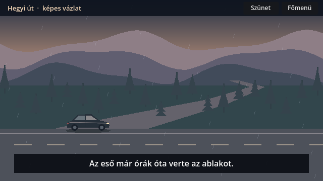
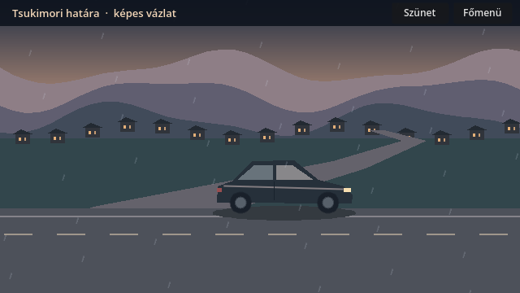
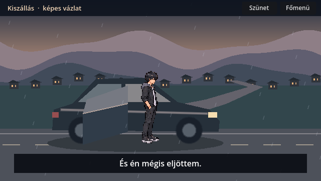

# Autós érkezés · képes időzítési próba

Godot 4.7.2, 2026-11-04, kiinduló commit `a7caa86`. A **Fejezetválasztás → Autós nyitány · próba** pont egy 20,8 másodperces animált képes vázlatot indít. A játék rendes indítása továbbra is a korábbi nyitányra vezet.

| Idő | Kép | Meglévő szöveg és hang |
|---|---|---|
| 0–7,6 mp | Akira autója az erdős hegyi úton | „Az eső már órák óta verte az ablakot.” → „Katsuro hívott vissza.” Eső és motor. |
| 7,6–14 mp | Az első falukép, lassítás, parkolás a falu szélén | „Tsukimori ugyanolyan csendesnek tűnt, mint régen.” A motor 11,6 mp körül elhallgat. A szöveg eltűnik, az eső tovább hallatszik. |
| 14–20,8 mp | Ajtónyitás, kiszállás, talajérintés, ajtócsukás | A lépés után „És én mégis eljöttem.” Ezután újrajátszás vagy visszatérés a főmenübe. |

**IMPLEMENTED és tesztelt.** Önálló jelenet, automatikus képsor, szünet, újrajátszás és kilépés szünetből. A szövegek a meglévő `data/opening/sequence.json` monológjából jönnek. A hangok a játék meglévő `ambience.gd` lejátszóját használják. A próba nem ír történeti állapotot.

**REVIEW / PLACEHOLDER.** A hegyek, az autó, a parkoló és az ajtó mozgó kompozíciós vázlat. Akira a meglévő `assets/opening/staging_v3/akira_atlas.png` oldalnézeti figurája. A jármű színe és formája tesztgrafika. A jelenet három Texture2D helye fogadja az eredeti képeket.

**MISSING.** A három jóváhagyott autós CG bináris fájlja. A [kánonátadás](https://github.com/likop93/Tsukimori-Z-rt-Vil-g/pull/1) dokumentálja a három kép elfogadását. A hozzáférhető projektchat-kivonatokban, a vizsgált Git-ágakon, helyi projektmappákban és a név alapján ellenőrzött Tsukimori-ZIP-ekben nem sikerült azonosítani az eredeti három képet. Az eredeti grafika, képkivágás és a következő gyalogos jelenethez illeszkedés ellenőrzése még hátravan.

**Godot-futások.** A grafikus és a headless jelenetteszt sikeres. Ellenőrizte a főmenüből indítást, a snittek sorrendjét, a motor leállását, az olvasási szünetet, az újrajátszást és a főmenübe visszatérést a flagek megőrzésével. A fejezetválasztó regresszió és a normál nyitány → kapu → Miyako teszt is sikeres. [Naplók és három képkocka](car_arrival_review_2026_11_04/).

