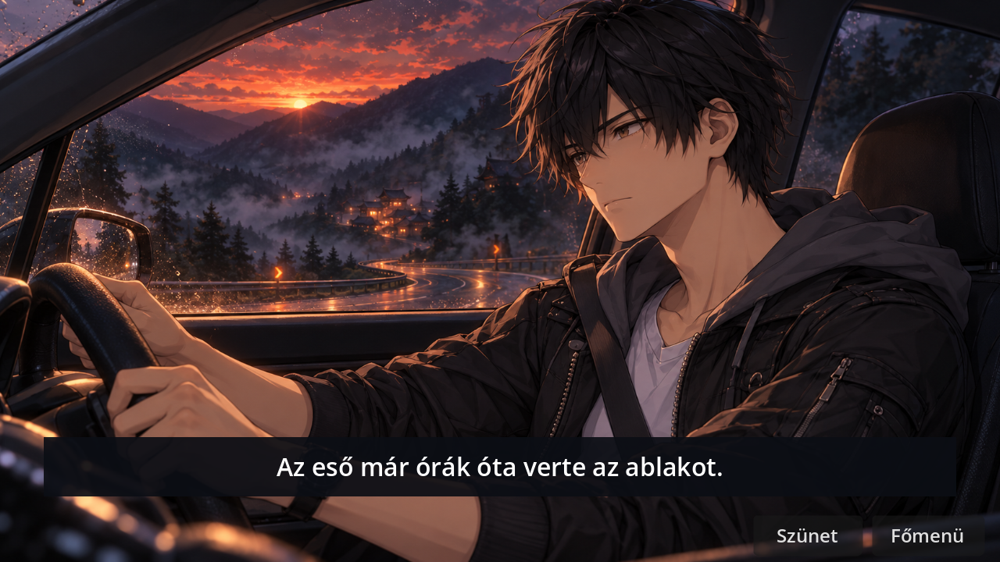
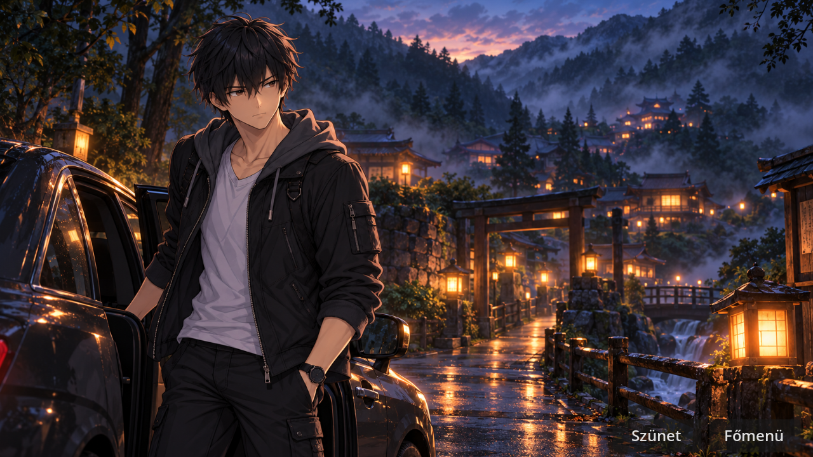
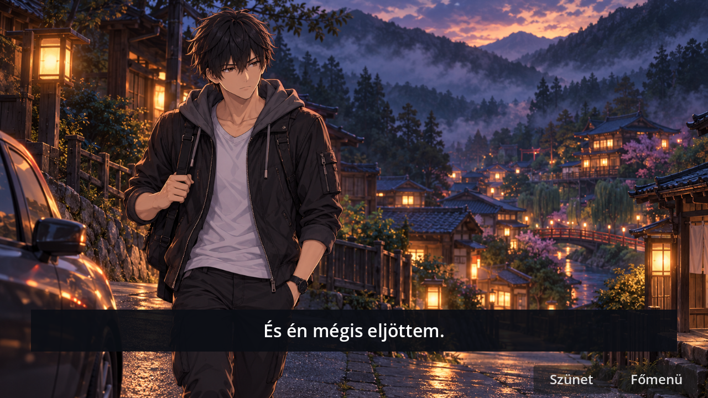

# Autós nyitány · filmes próba az eredeti képekkel

**Kipróbálás:** Fejezetválasztás → Autós nyitány · próba. Időtartam 20,8 másodperc. A három tulajdonosi REVIEW-kép a beküldött ZIP-ből származik. Az import előtt ellenőriztük mindhárom eredeti PNG méretét (1672×941) és a [forráscsomag SHA-256 jegyzékét](../assets/opening/car_arrival/MANIFEST_SHA256.json).

| Idő | Beállítás | Hang és monológ |
|---|---|---|
| 0–7,6 mp | Akira a volánnál, az alkonyati hegyi út és a falu fényei | Eső, motor, „Katsuro hívott vissza.” A motor 5,2–7,2 mp között halkul el. |
| 7,6–14 mp | A falu szélén a nyitott ajtó mellett áll | Ajtónyitás és lépés, falukép, felirat nélküli szünet, majd ajtócsukás. |
| 14–20,8 mp | Akira vállán a táskával gyalog elindul | Lépések és eső. „És én mégis eljöttem.” |

**Tesztelt működés.** A külön menüpontból elérhető próba ablakfelbontásban, lineáris szűréssel jelenik meg. A felirat és a kezelőszervek külön rétegen vannak. A szünet, az újrajátszás és a főmenübe való visszatérés működik. Kilépéskor visszaáll a játék eredeti megjelenítési módja. A menüpróba megőrzi a történeti jelzőket.

**Térbeli folytonosság.** A híd már a második és a harmadik képen látható a háttérben. A próba az átkelés előtt ér véget. A távoli épületekhez nem rendel helyszínazonosítót. Az átkelés és Miyako házának megközelítése a következő szakasz.

**Godot 4.7.2.** [A futások naplói és 1280×720-as képkockái](car_arrival_cg_review_2026_11_04/). A képek bekötése a car_arrival_preview.tscn fájlban, az időzítés és a helyi megjelenítési mód a car_arrival_preview.gd fájlban, az ellenőrzések a car_arrival_preview_regression.gd fájlban találhatók. [A korábbi vázlat dokumentációja](https://github.com/likop93/Tsukimori-Z-rt-Vil-g/blob/7903c36/docs/CAR_ARRIVAL_TIMING_REVIEW.md).

