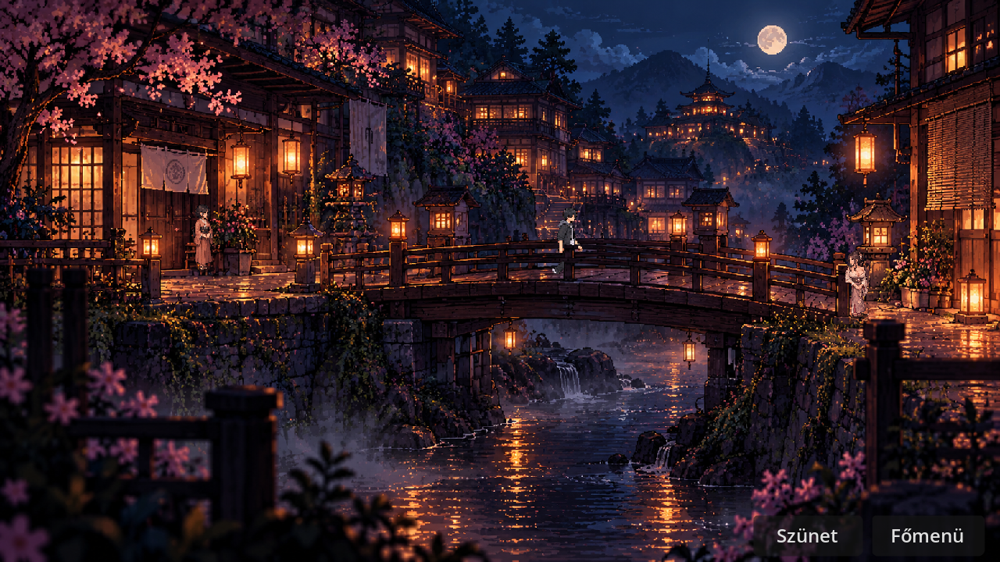
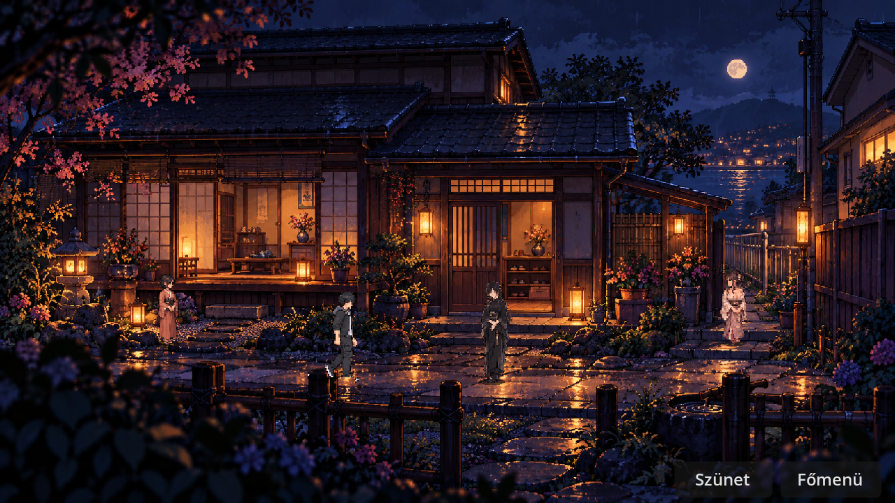
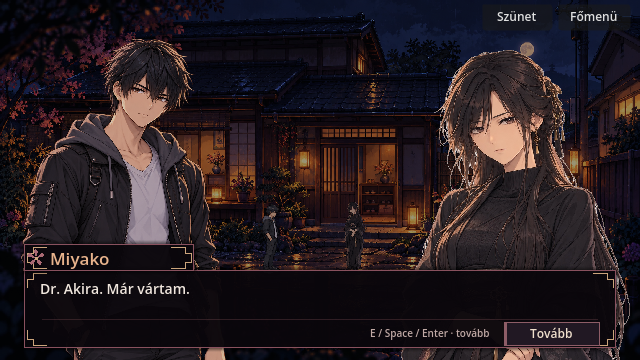

# A hídtól Miyako első mondatáig

A **Fejezetválasztás → Autós nyitány · próba** a volánnál kezdődik, és most már ugyanabban a lejátszásban elvezet az első, olvasó által léptetett beszélgetésig.

| Idő | Beállítás és történés |
|---|---|
| 0–20,8 mp | A három eredeti autós CG, parkolás, ajtócsukás és elindulás. |
| 20,8–33 mp | Balról jobbra átkelés az esti hídon. A lépés hangja kőről deszkára vált, felerősödik a patak. Akira gondolata: „Csak a csendje lett nehezebb.” Ezután a túlsó lámpásnál megáll egy falusi nő, és Akira felé fordul. |
| 33–38 mp | Miyako házának meglévő külső tágképe. Akira balról érkezik, megáll a bejáratnál. |
| 38–47 mp | A közös Akira–Miyako Living CG, majd áttűnés a meglévő kompakt párbeszédre. A mondatok léptetését a játékos vezérli. Az utolsó nyugtázás után újrajátszás vagy főmenü választható. |

**Megvalósítás.** A próba a meglévő Village Street hídfelületét, korlátmaszkját, járásanimációját, falusi figuráit és házképét használja. Az útvonalat a jelenet vezérli. A találkozást ugyanaz az arrival_director és VN-megjelenítő játssza le, mint a történeti játékban. A próbában a befejezés visszaadja a menüvezérlést, megőrzi a játékállapotot.

**REVIEW.** Az új patakhang és deszkalépés szintetizált próbahang. A két tágkép meglévő esti pixelgrafika. A házképről a találkozás melegebb, részletgazdag anime-képére váltás továbbra is vizuális illesztési pont. A főmenü normál játékindítása a korábbi nyitányt indítja.

**Teszt.** Godot 4.7.2, grafikus futás. A külön próba tesztelte a hídon a talajkövetést, a figyelő nő megállását, a szünetet, a házra vágást, a Living CG természetes befejezését, az első mondatot, a kézi dialógusléptetést, a jelzők megőrzését és az újrajátszást. A normál nyitány, a rendes első VN és a házba belépő két válaszág regressziója is sikeres. [A négy végső napló és a Godot-képkockák](car_bridge_review_2026_11_04/).

