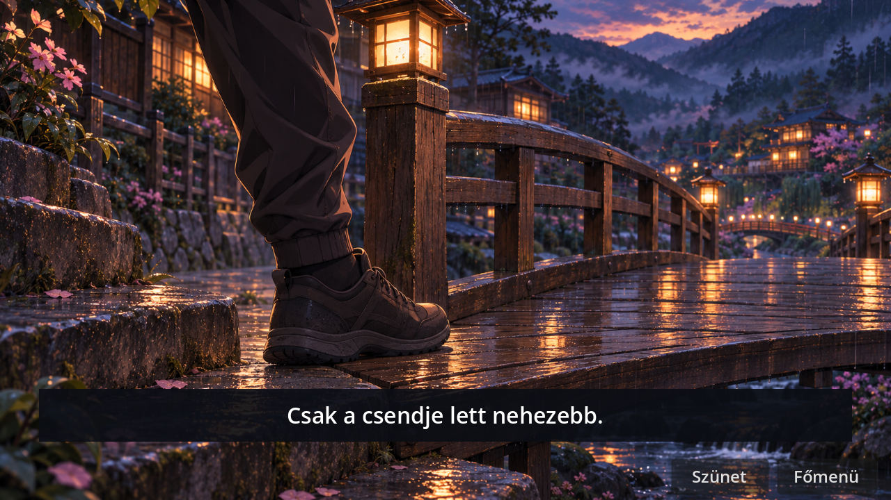
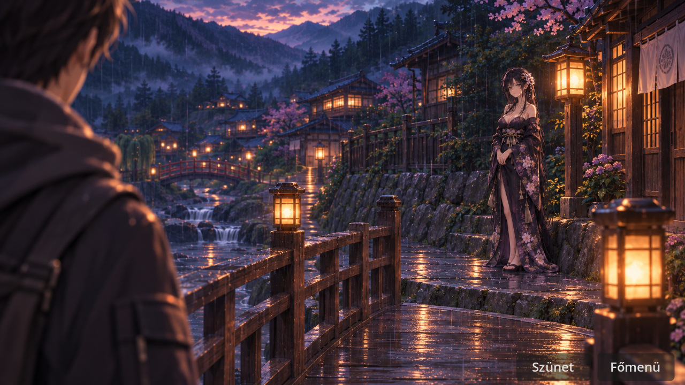
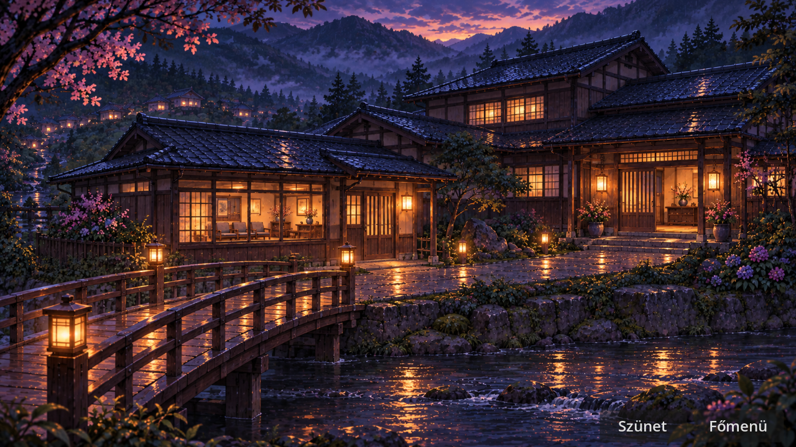

# A hídtól Miyako első mondatáig · filmes REVIEW

A folyamatos történeti változat aktuális időzítése, előnézete és tesztjei az [emlék és történeti próba jelentésében](CAR_MEMORY_STORY_REVIEW.md) találhatók. Az alábbi időzítés az ezt megelőző hídi egységhez tartozik.

**Korábbi próba:** Fejezetválasztás → Autós nyitány · próba. A három eredeti autós kép után három új, referenciákból készített anime-beállítás következik. A meglévő Living CG a 38. másodpercnél indul.

| Idő | Beállítás és hang |
|---|---|
| 20,8–26,8 mp | Akira cipője a nedves kő és az első deszka határán. Három kőlépés után, 22,7 mp körül megszólal az első falépés. A felvett patakzúgás felerősödik az eső alatt. „Csak a csendje lett nehezebb.” |
| 26,8–33 mp | Visszatekintés a falusi partra Akira válla fölött. Shion a járósávon kívül, a megemelt oldalsó ösvényen, lámpás mellett áll. A tekintete és a tartása viszi a jelenetet, szöveg nélkül. |
| 33–38 mp | Nagytotál a falusi partról a túlpartra. A híd a külön bejáratú, alacsonyabb rendelőszárnyhoz vezet. Jobbra, beljebb nyílik a közös ház főbejárata. Elhalkul a víz. |

**Kánon.** [A falubejárás 5–7. szakasza](FIRST_VILLAGE_10_15_MIN_FLOW.md) és a [Shion-cameo elhelyezése](HANA_SHION_CAMEOS_REVIEW.md) igazolja a néma megfigyelőt. A két bejáratról és a híd felőli rendelőszárnyról a [térbeli rendezési terv](BEAUTY_TARGET_AKIRA_MIYAKO_ARRIVAL.md) és a döntési napló rendelkezik.

**Assetstátusz.** Az új három CG vizuális jóváhagyásra vár. A [pontos beállítások, referenciák és képkészítési utasítások](../assets/opening/car_arrival/bridge_cgs/REVIEW.md) és a [hangfelvételek szerzői, licencei](../assets/opening/car_arrival/audio/CREDITS.md) a fájlok mellett találhatók. Csak a filmes előnézet használja ezeket a képeket. A korábbi pixelpróba történeti felvételei külön mappában maradtak.

**Ellenőrzés.** Godot 4.7.2, grafikus futás. Az autós előnézet végigment a három képen, a két külön felülethangon, a szüneten, az eredeti Living CG-n, a kézzel léptetett köszöntésen, az újrajátszáson és a főmenübe visszatérésen. A flag-ellenőrzés, a VN-regresszió és a Living CG mechanikateszt sikeres. A három végső játékfutás naplójában nincs hiba vagy figyelmeztetés. Az editor importáláskor külön safe-save figyelmeztetést adott; az összes új képet és hangot importálta, és a játék betöltötte őket.

**1280×720-as játékbeli képkockák.**

