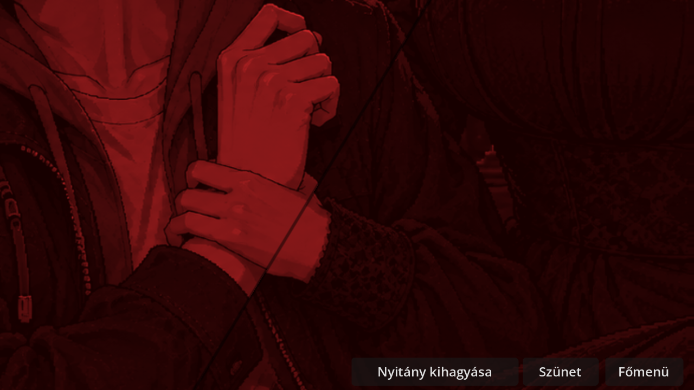
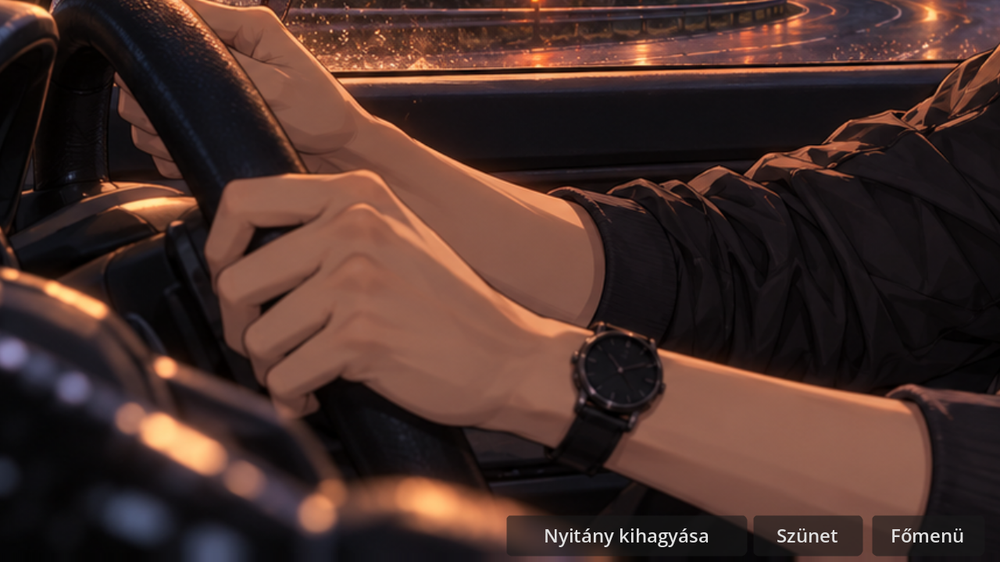
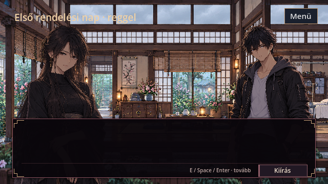

# Autós nyitány – emlék és folytonos történeti próba

A **Fejezetválasztás → Autós nyitány · próba** új, 0. napi játékállapotból indul. A jelenlegi egység az első rendelésig ellenőrzött. A normál „Játék indítása” az eredeti nyitányt indítja. A főmenü átállítása külön tulajdonosi döntés.

[Hangos Godot-előnézet, MP4, 12 mp](car_memory_story_review/opening_memory.mp4)

| Idő | Beállítás |
|---|---|
| 3,50–6,55 mp | Akira a volánnál. Az eredeti „Katsuro hívott vissza.” felirat. |
| 6,55–9,20 mp | Négy rövid, új felirat nélküli vágás: érintés az állnál, fogás a csuklón, mandzsetta, szűkülő kivágás. Vörös tónus, elmozduló képsík, tompa hang. |
| 9,20–11,20 mp | Az eredeti autós kép kormányt fogó keze. Elhallgat az emlék, rövid csend után visszatér az eső. |
| 11,20–41,60 mp | Kiszállás, gyalogos megközelítés, kő–fa lépések és patak, Shion a falusi parton, a túlparti ház és rendelő. |
| 41,60 mp után | A meglévő Living CG, majd az olvasó által léptetett első köszöntés. Utolsó nyugtázása után közvetlen belépés a közös otthonba. |

**Képi forrás.** Az aktuális repó két ellenőrzött emlékképe a `memory_warm_REVIEW.png` és a `memory_cold_REVIEW.png` az `assets/opening/cinematic_v2` mappában. A Godot shader az eredeti érintésből, kézből és mandzsettából vág ki részleteket. A képeken az ex arca részben takart, a kivágás ezt megtartja. A jelenben Akira a jóváhagyott, szemüveg nélküli autós CG-n szerepel. A visszavágás ugyanennek a képnek a részlete. Nem készült új arc vagy karakterdizájn.

**Történeti belépés.** A filmes jelenet egyszer használható belépési kérést ad a normál történeti jelenetnek. Az első köszöntés lezárása rögzíti a találkozást. A házbeli választást az eredeti interior_director dolgozza fel. A próba a beszélgetés végeztével a meglévő szobajelenetbe lép. Az első éjszaka felfedezése, a fénykép, a lefekvés és a „Reggel · folytatás” eredeti döntései végigjátszhatók. Shion megpillantása nem hoz létre bemutatkozást vagy kapcsolatfeloldást.

**Godot 4.7.2 teszteredmények.** A valós menüből három út futott az első páciens lezárásáig. Természetes lejátszás és Skip az emlék közben azonos válaszokkal teljesen egyező flaglistát, döntéseket, időt és pontszámokat adott. Mindkét esetben az eredeti első mondat állt a képernyőn a találkozás rögzítése előtt. A harmadik út azonnali Skippel és más válaszokkal futott. A listen/stay/empathy esetén a Miyako/Hana/Shion/gyógyulás értékek 2/1/1/3, ask/withdraw/clinical esetén 0/0/0/0 lettek. Az éjszaka végén még 0. nap, a reggel folytatásakor 1. nap, a rendelésen 1. nap / clinic. A szokásos házbelépés, az éjszaka–rendelés és a normál nyitány regressziója is sikeres volt. A négy végső tesztnapló és a felvételi napló a képek mappájában van.

