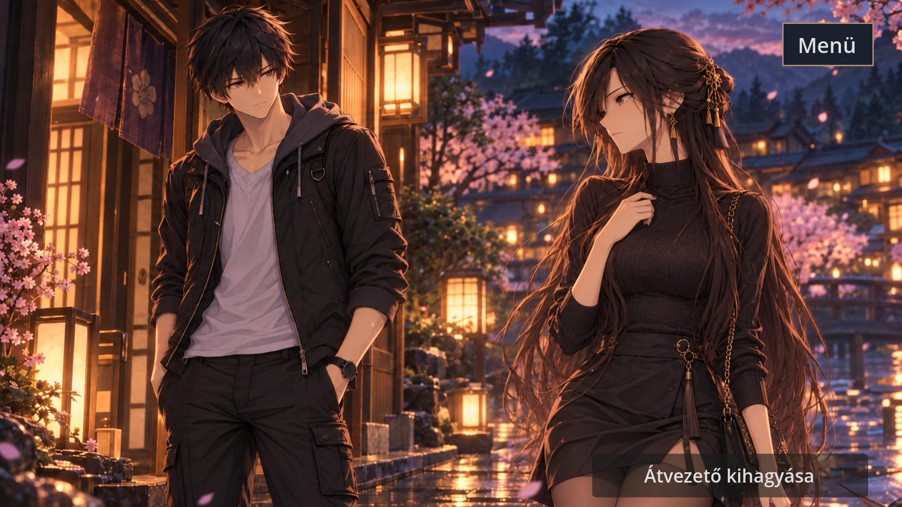
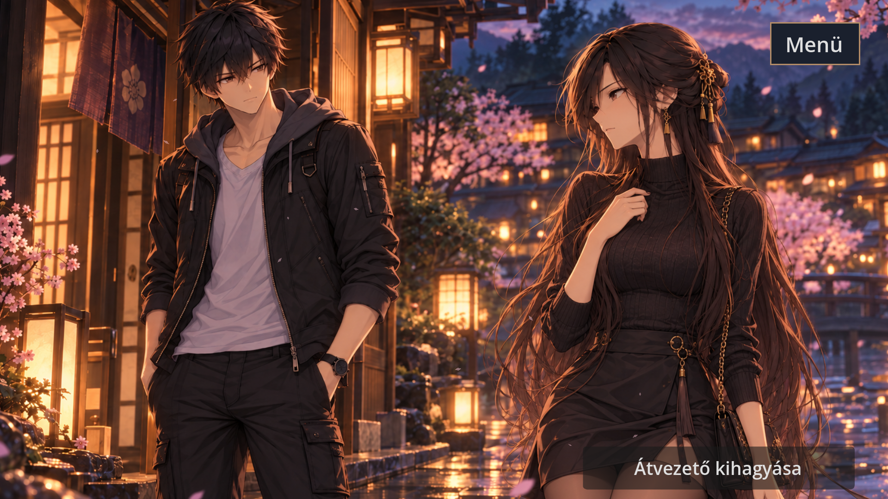
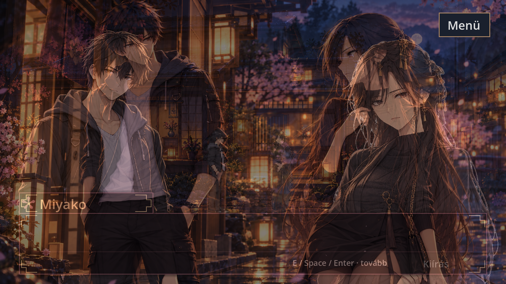
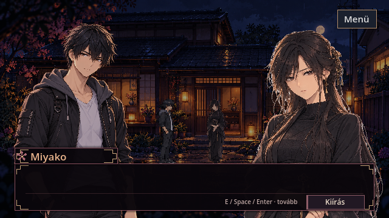
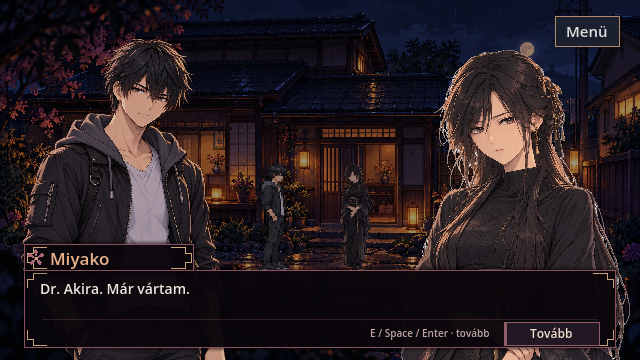

# Living CG — tényleges Godot-képkockák

Godot 4.7.2, Compatibility/OpenGL, 1920×1080 ablak. A CG képkockái 1920×1080 felbontásúak; a VN a korábban elfogadott 640×360 viewportot állítja vissza. Nincs utólagos képszerkesztés.

Az első öt kép egy természetes lejátszásból származik. A hatodik a kapcsolódó VN-regresszió olvasható első mondata. A teljes mozgás Godotban fut; ez ellenőrző képkockasorozat, nem videó.

## 1 másodperc

## 4 másodperc

## 7,8 másodperc

## 8,6 másodperc

## 9 másodperc — vezérlés átadása

## A meglévő VN első mondata

A CG és a VN közötti háttér-, nézőpont- és részletességváltás REVIEW. Akira balra és Miyako jobbra marad; a meglévő szöveg és kompakt elrendezés változatlan.
